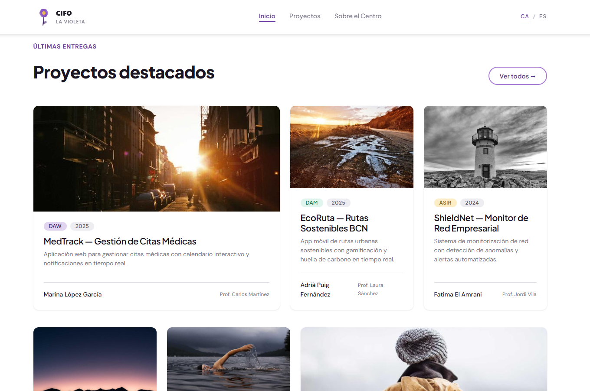
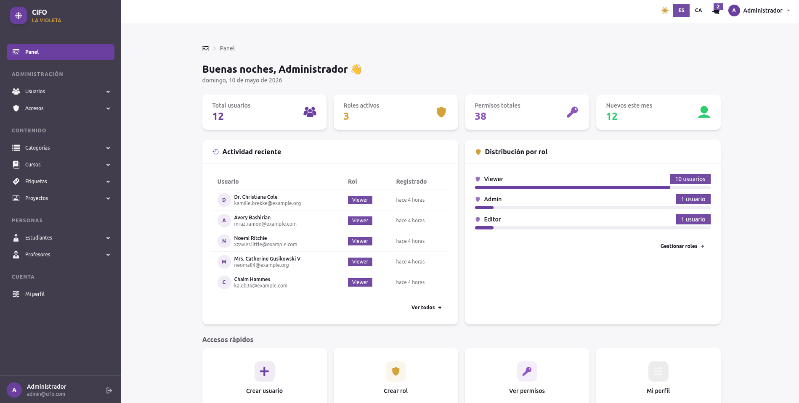
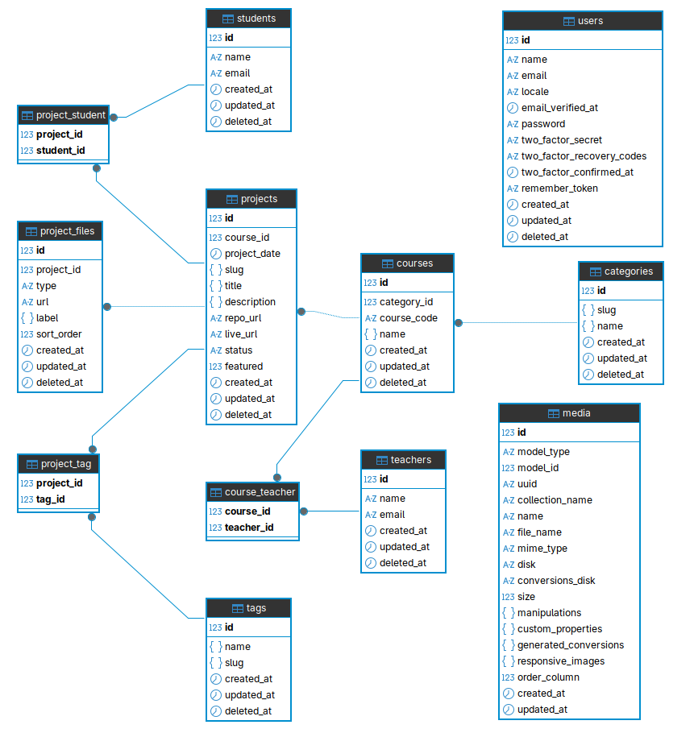
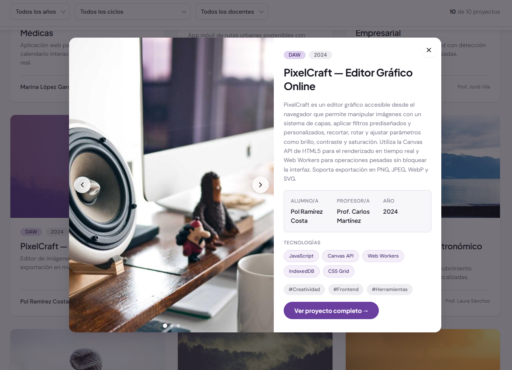
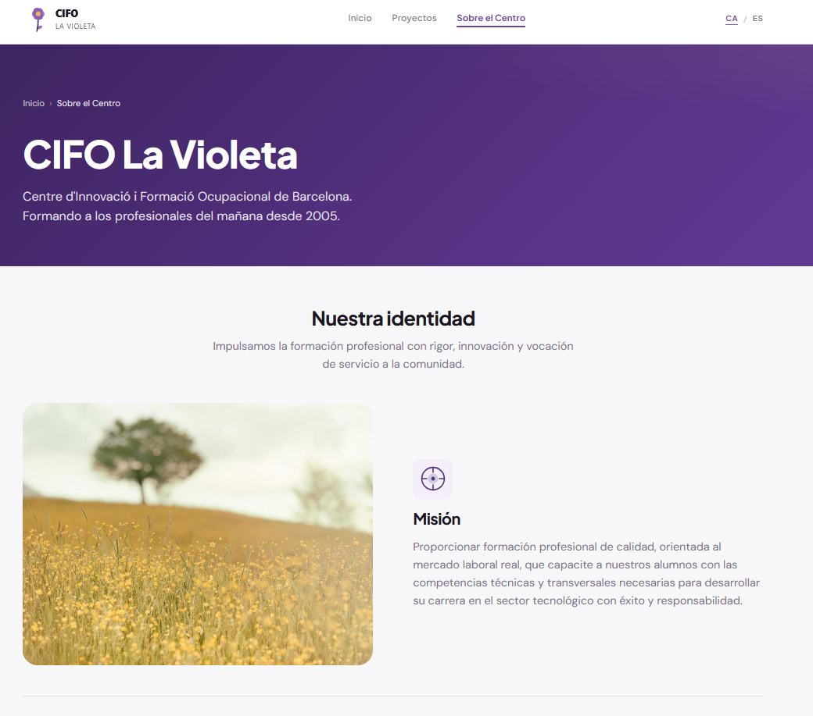
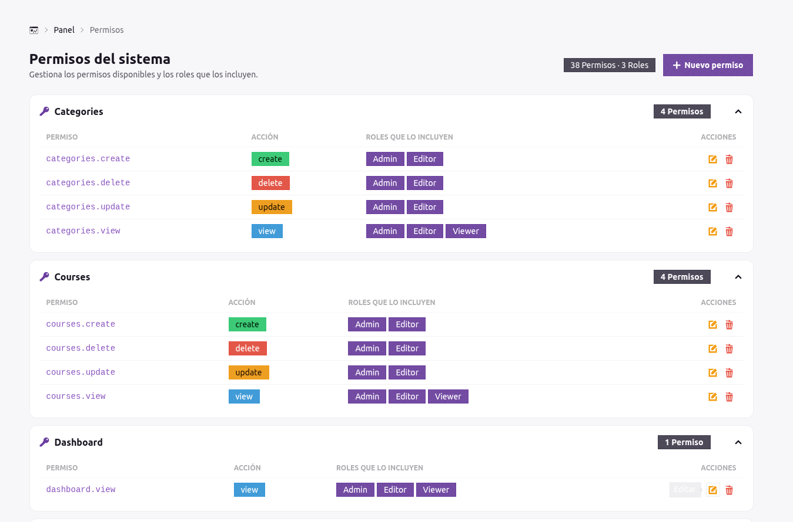
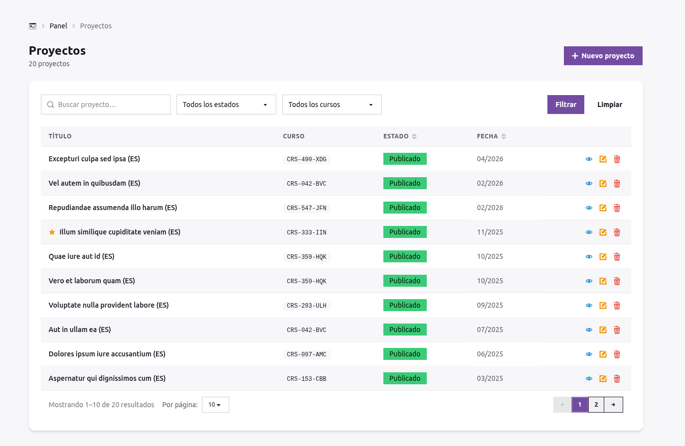

# 📒 SHOWCASE — Plataforma de Portafolios Institucionales

> **Aviso:** Este repositorio es un fork independiente de
> [cifo-showcase-app](https://github.com/germansango01/cifo-showcase-app),
> el proyecto original en el que participé como integrante. Esta versión
> incorpora algunas variaciones propias y no es el repositorio oficial del
> proyecto original.
>
> El crédito por el proyecto original y su base sigue siendo de
> **Germán Contreras** y **Franco Calderón**.

## Curs Confecció i Publicació de Pàgines Web 2026

### CIFO Barcelona La Violeta

---

## 🎯 Descripción

SHOWCASE es una plataforma web desarrollada para la gestión y publicación de proyectos académicos realizados por alumnos del CIFO.

<!--  -->

<p align="center">


</p>

La aplicación combina:

```text
✔ Portal público institucional
✔ Repositorio digital de proyectos
✔ Escaparate profesional para estudiantes
✔ WebApp administrativa de gestión de contenido
```

El objetivo principal es evitar la pérdida del patrimonio intelectual generado durante cada promoción académica, permitiendo conservar, organizar y publicar los trabajos finales realizados por los alumnos.

La plataforma busca conectar:

```text
formación + visibilidad profesional + empleabilidad
```

Además, proporciona al centro educativo un sistema centralizado para mantener un histórico digital e institucional de los proyectos desarrollados.

---

## 🧠 Objetivo del proyecto

Este proyecto tiene un enfoque académico y formativo, desarrollado como trabajo final del curso:

```text
Confecció i Publicació de Pàgines Web
```

Realizado en:

```text
CIFO Barcelona La Violeta
Barcelona - España
Dic 2025 → May 2026
```

El proyecto busca poner en práctica los conocimientos adquiridos durante el curso, integrando tecnologías modernas de desarrollo web y aplicando conceptos utilizados en aplicaciones reales.

---

## 🧩 Tecnologías utilizadas

```text
Frontend
```

- HTML5
- CSS3
- JavaScript
- TailwindCSS
- DaisyUI

```text
Backend
```

- PHP
- Laravel

```text
Base de datos
```

- MariaDB

---

## ✨ Funcionalidades principales

La plataforma incorpora funcionalidades tanto públicas como administrativas.

### 🌐 Portal público

- navegación multiidioma
- selector Catalán / Español
- detección automática del idioma del navegador
- listado de proyectos
- filtros y ordenamiento
- paginación
- modo día/noche
- diseño responsive
- sliders de imágenes
- modales y componentes UI modernos

---

### 🔐 WebApp administrativa

```text
✔ Registro de usuarios
✔ Login
✔ Confirmación vía correo electrónico
✔ Gestión de perfiles
✔ Roles y permisos
✔ CRUDs completos
✔ Dashboard administrativo
✔ Gestión dinámica de contenido
✔ Subida de imágenes
✔ Gestión de archivos asociados a proyectos
✔ Enlaces externos y documentación
```

---

## 🧠 Arquitectura del proyecto

La aplicación utiliza arquitectura:

```text
MVC (Model - View - Controller)
```

Aplicando principios de:

- separación de responsabilidades
- reutilización de componentes
- modularidad
- mantenimiento escalable
- organización por capas

---

## 🗂️ Estructura del proyecto

```text
.
├── app
│   ├── Actions
│   │   └── Fortify
│   ├── Enums
│   ├── Http
│   │   ├── Controllers
│   │   │   ├── Admin
│   │   │   └── Front
│   │   ├── Middleware
│   │   └── Requests
│   ├── Models
│   ├── Providers
│   └── View
│       └── Components
│           └── Admin
├── database
│   ├── factories
│   ├── migrations
│   └── seeders
├── lang
│   ├── ca
│   └── es
├── routes
└── storage
    ├── app
    ├── framework
    ├── logs
    └── media-library
```

---

## 🗃️ Base de datos

### Tablas principales

```text
categories
course_teacher
courses
media
project_files
project_student
project_tag
projects
students
tags
teachers
users
```

---

## 🔗 Relaciones de la base de datos

<!--  -->

<p align="center">

</p>

---

## ⚙️ Instalación

### 1. Preparar entorno

Descargar y descomprimir el proyecto.

Instalar:

- XAMPP (Apache + MySQL/MariaDB)
- PHP Composer
- NodeJS

---

### 2. Configurar variables de entorno

Crear archivo:

```text
.env
```

A partir de:

```text
.env.example
```

Configurar:

- conexión a base de datos
- parámetros del servidor Apache
- URL base de la aplicación
- `APP_ENV`, `APP_DEBUG`, `ADMIN_NAME`, `ADMIN_EMAIL`, `ADMIN_PASSWORD`

---

### 3. Instalación en desarrollo

Con la base de datos de desarrollo configurada:

```bash
composer install
php artisan key:generate
php artisan migrate:fresh
php artisan db:seed
php artisan db:seed --class=DemoSeeder   # opcional: usuarios y contenido de prueba
php artisan storage:link
npm ci
npm run build
```

`db:seed` es seguro en cualquier entorno: crea permisos, el rol `Admin`, el primer usuario Admin, las categorías base y las filas de `SiteImage`, sin datos demo.

Si usas Docker, ejecuta los comandos dentro de `laravel.test`:

```bash
docker compose exec -u sail laravel.test php artisan migrate:fresh
docker compose exec -u sail laravel.test php artisan db:seed
docker compose exec -u sail laravel.test php artisan db:seed --class=DemoSeeder
```

---

### 4. Instalación en producción

En el `.env` del servidor:

```env
APP_ENV=production
APP_DEBUG=false
ADMIN_NAME=...
ADMIN_EMAIL=...
ADMIN_PASSWORD=...
```

`ADMIN_*` solo se usan para crear el primer usuario Admin cuando no existe ninguno.

```bash
composer install --no-dev --optimize-autoloader
php artisan key:generate
php artisan migrate --force
php artisan db:seed --force
php artisan storage:link
php artisan config:cache
php artisan route:cache
npm ci
npm run build
```

No ejecutes `DemoSeeder` en producción: aborta automáticamente.

---

### 5. Acceder a la aplicación

Abrir en navegador:

```text
Depende de server local XAMPP:
http://localhost/carpeta/public/es

Si tienen configurado un virtualhost Local:
http://cifoapp.test
```

---

## 🔐 Acceso por defecto

En desarrollo, los valores por defecto son:

```text
Usuario: admin@cifo.com
Password: admin123
```

En producción se definen con `ADMIN_NAME`, `ADMIN_EMAIL` y `ADMIN_PASSWORD` antes del primer `db:seed`.

### Credenciales del Admin

- `ADMIN_*` solo se usan la primera vez, cuando no existe ningún usuario con rol `Admin`.
- Después del primer arranque, la fuente de verdad es la base de datos.
- El nombre y la contraseña pueden cambiarse desde “Mi perfil”; el `.env` deja de reflejarlos.
- El correo electrónico es inmutable: solo se define al crear la cuenta.
- Reejecutar `db:seed` no duplica usuarios ni roles y no sobreescribe credenciales existentes.
- El rol `Admin` no se puede asignar, quitar, eliminar ni transferir desde la aplicación.
- Para dar privilegios totales a otro usuario, crea un rol propio (por ejemplo `SUPERVISOR`) y asígnale todos los permisos. Ese rol no recibe automáticamente los permisos nuevos.
- Si se modifica el `.env` en el servidor, ejecuta `php artisan config:cache` (o `config:clear`) para recargar la configuración.

---

# 🧭 Flujo principal de la WebApp

## 🔄 Navegación administrativa

```text
LOGIN
   ↓
DASHBOARD
   ↓
MENÚ ADMINISTRATIVO
```

---

## 📂 Estructura funcional

```text
Administración
│
├── Usuarios
│   ├── Listado (CRUD)
│   └── Crear nuevo
│
├── Accesos
│   ├── Roles (CRUD)
│   └── Permisos (CRUD)
│
Contenido
│
├── Categorías
│   ├── Listado (CRUD)
│   └── Nuevo
│
├── Cursos
│   ├── Listado (CRUD)
│   └── Nuevo
│
├── Etiquetas
│   ├── Listado (CRUD)
│   └── Nuevo
│
├── Proyectos
│   ├── Listado (CRUD)
│   └── Nuevo
│
Personas
│
├── Estudiantes
│   ├── Listado (CRUD)
│   └── Nuevo
│
├── Profesores
│   ├── Listado (CRUD)
│   └── Nuevo
│
Cuenta
│
├── Mi perfil
│
└── Logout
```

---

# 🌐 Flujo del portal público

```text
Inicio
   ↓
Explorar proyectos
   ↓
Filtrar / Buscar
   ↓
Ver detalle del proyecto
   ↓
Consultar archivos e información relacionada al CIFO
```

---

## 🧩 Conceptos trabajados

- arquitectura MVC
- Laravel
- Eloquent ORM
- relaciones many-to-many
- internacionalización (i18n)
- autenticación y autorización
- middleware
- validaciones
- CRUD completo
- paginación
- filtros dinámicos
- componentes reutilizables
- responsive design
- gestión de archivos
- organización modular
- dashboards administrativos

---

## 🌍 Internacionalización

La aplicación incorpora soporte multiidioma:

```text
✔ Catalán
✔ Español
✔ estructura preparada para Inglés
```

Utilizando:

```text
/lang
```

Como sistema centralizado de traducciones.

---

## 📁 Gestión multimedia

La plataforma permite:

- subida de imágenes
- almacenamiento de archivos asociados a proyectos
- gestión de recursos multimedia
- enlaces externos
- documentación complementaria

---

## 🎨 Interfaz y experiencia de usuario

El Backend (Dashboard) fue diseñado utilizando:

- TailwindCSS
- DaisyUI

El frontend fue diseñado utilizando:

- CSS Moderno
- Javascript vanilla

Incorporando:

```text
✔ diseño responsive
✔ modo oscuro/claro
✔ componentes modernos
✔ navegación adaptable
✔ interfaz administrativa organizada
```

---

## 👥 Integrantes del proyecto

```text
Germán Contreras
Franco Calderón
```

---

## 👤 Asesor del Proyecto

```text
Profesor: Manel Plaza
```

---

## 🔗 Repositorio original

[Repositorio original](https://github.com/germansango01/cifo-showcase-app.git)

---

## 📸 Capturas del proyecto

<!-- 
 -->

### 🌈 FrontEnd

<p align="center">


</p>

### 🗄️ BackEnd

<p align="center">


</p>

---

## 🧠 Idea principal del proyecto

```text
SHOWCASE no es solamente una aplicación CRUD.

Es una plataforma diseñada para preservar,
organizar y visibilizar el trabajo académico
realizado por los estudiantes del CIFO.
```

---

## 🚀 Proyección

La plataforma fue desarrollada con una estructura preparada para evolucionar hacia un entorno real de producción, permitiendo futuras mejoras como:

- integración con APIs
- búsqueda avanzada
- perfiles públicos
- analíticas
- panel institucional
- sistema de publicación automatizado
- almacenamiento cloud
- métricas de empleabilidad

---
